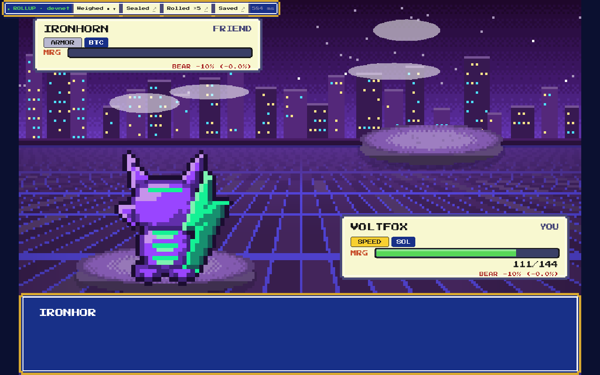
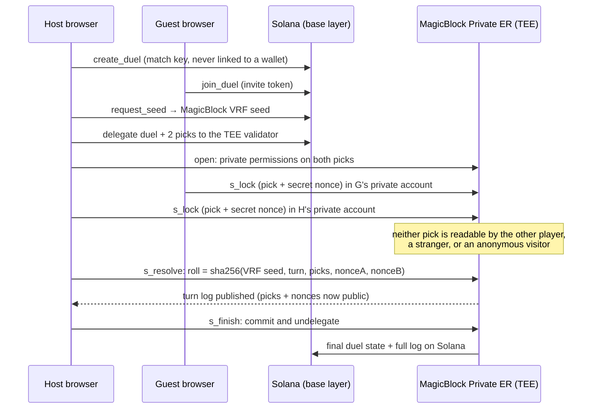
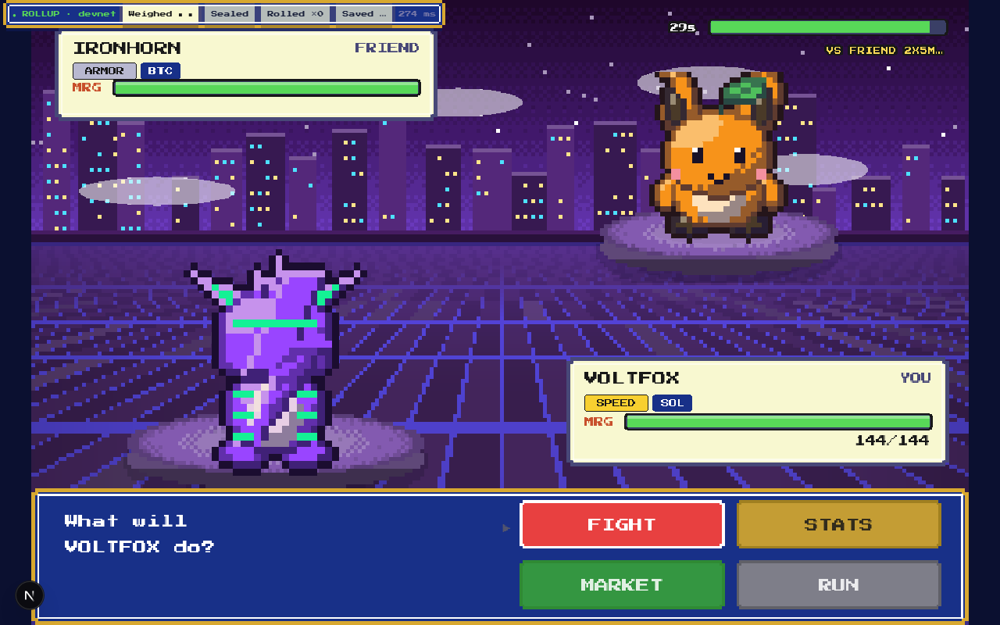
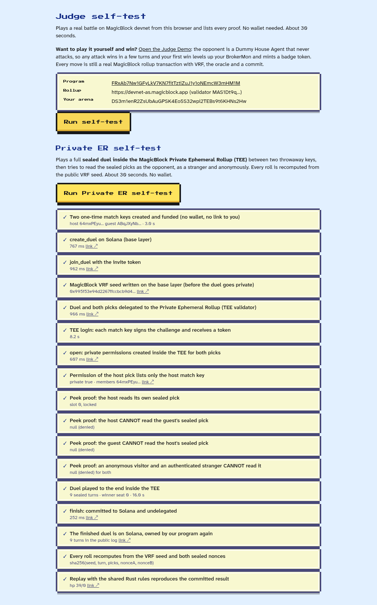
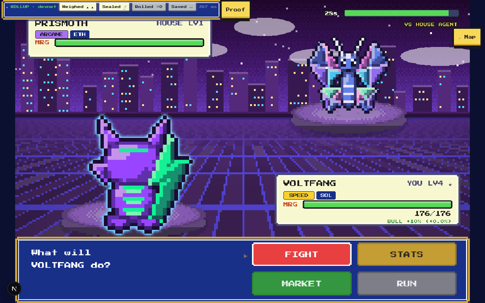
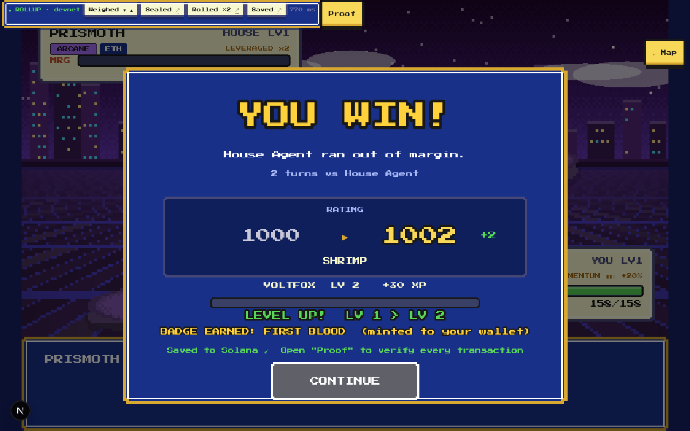
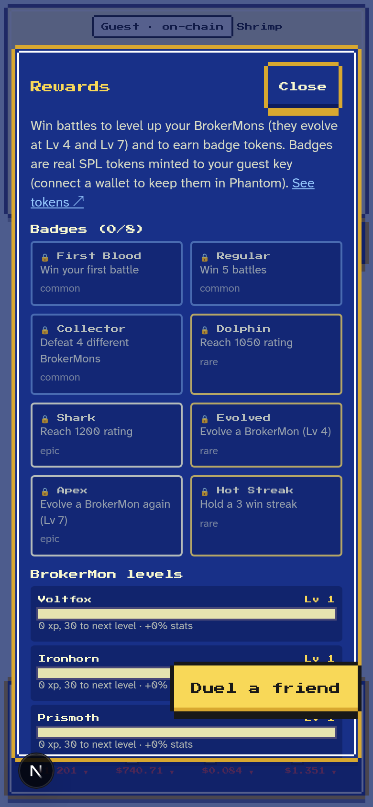
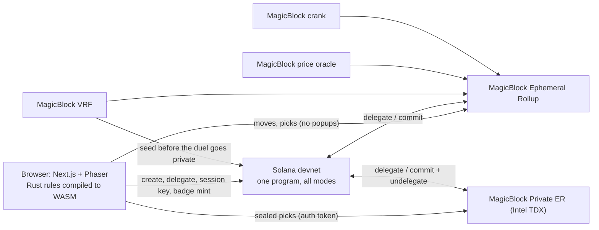

<div align="center">

# PokeStonksss
### A crypto creature battler where **MagicBlock rollups are the whole game server**

Beat a BrokerMon, capture its asset as a trophy token, level up, evolve. Every move is a rollup transaction, every roll is verifiable randomness, and 1v1 duels run **inside a Private Ephemeral Rollup (TEE) where nobody, not even your opponent, can read your pick.**

[](https://pokestonksss.vercel.app/?demo=1)
[](https://pokestonksss.vercel.app/judges)
[](https://github.com/Abhishek222983101/pokestonksss/actions)




</div>

---

## Judges: start here (2 minutes, no wallet needed)

| Step | Click | You will see |
|---|---|---|
| **0. Watch** | [**Demo video + download** on the judges page](https://pokestonksss.vercel.app/judges) | The whole project in 2 to 3 minutes |
| **1. Play** | [**pokestonksss.vercel.app/?demo=1**](https://pokestonksss.vercel.app/?demo=1) | Guest in one click, walk into grass, beat the demo opponent in 2 to 4 turns. Level up, trophy token, badge |
| **2. Prove the Private ER** | [**/judge** > *Run Private ER self-test*](https://pokestonksss.vercel.app/judge) | A full sealed duel inside the TEE in ~30 s. Four **peek proofs** show the opponent, a stranger and an anonymous visitor all read `null`. Every roll recomputed, result replayed from Solana |
| **3. Two browsers** | [Judges page, section 3](https://pokestonksss.vercel.app/judges) | Duel yourself from two windows. Press **Proof > Peek at my opponent** mid-match |
| **4. Every claim, with evidence** | [`docs/PROOFS.md`](docs/PROOFS.md) | Claim, how to verify it by hand, and the automated test that checks it |

Everything is on **Solana devnet**. Nothing here has cash value.

---

## The problem

On-chain games have three problems that keep them from feeling like games:

1. **They are slow.** Every move asks for a signature and waits for a block, so real-time play is impossible.
2. **They cannot keep secrets.** A chain is public. In any simultaneous-move game ("both players pick at once") the second mover can read the first mover's pick, so you either trust a server or give up the game.
3. **Randomness is trusted.** If the developer rolls the dice, the player cannot tell if the game is rigged.

Studios solve this with a game server and a database. That server is exactly the part players have to trust, and the part that goes down.

## What we built

**PokeStonksss removes the game server.** Players pick a BrokerMon (one per crypto asset: SOL, BTC, ETH, SUI, ZEC, BNB, DOGE, XRP), walk a pixel route and battle. The market is part of the fight: live oracle prices change damage. Winning pays: XP, levels, evolutions, a **trophy token for every asset you take down**, and badge tokens, all minted from on-chain state.

- No server, no database, no cold start: state lives on MagicBlock rollups, results settle on Solana.
- Provably fair randomness: MagicBlock VRF.
- **Provably private simultaneous picks: MagicBlock Private ER.**

## Why now, and why MagicBlock

Fast, fair, private on-chain play only became possible this year: MagicBlock's Ephemeral Rollups give sub-second confirmation, VRF gives verifiable randomness, session keys remove popups, and the **Private ER (Intel TDX) with on-chain permissions** gives hidden state with public settlement. Our game needs every one of them, and none can be swapped for base-layer Solana:

| If we used only base Solana | What breaks |
|---|---|
| One tx per move at ~400 ms+ and a wallet popup each | A turn would take seconds and a fight would be unplayable |
| Public accounts | The second player reads the first player's pick. Simultaneous-move duels are impossible |
| Server-side dice | Players must trust us. With VRF they do not have to |

---

## The show-stopper: sealed duels in a Private Ephemeral Rollup

Both players lock a pick at the same time. Each pick lives in its own account, and **the account's permission lists only its owner's one-time match key**. The permission is created inside the TEE by our program, which derives the member list from the account itself (never from a client argument, so nobody can pre-create a public permission for the opponent).



**Why you can trust it, and how to check each piece**

| Guarantee | How it is enforced | Check it |
|---|---|---|
| Nobody can read a pick | EphemeralPermission with one member, enforced by the TEE. `s_lock` also refuses to run unless the permission is private and lists only the caller | Peek proofs on [/judge](https://pokestonksss.vercel.app/judge): own pick readable, opponent / stranger / anonymous get `null` |
| Nobody can predict or steer a roll | Roll mixes a MagicBlock VRF seed (written before the duel went private) with both players' sealed nonces | `/verify/sealed/<match key>` recomputes every roll |
| Nobody can probe the outcome by simulating | `s_resolve` requires a later slot than the last lock, so `simulate([lock(X), resolve])` is impossible | [`sealed.rs`](programs/pokestonksss/src/sealed.rs) `resolve` |
| The result is final and public | `s_finish` commits and undelegates; the finished account is owned by our program on Solana with the full turn log | Explorer link on the last row of the self-test |
| Rules are the same everywhere | One integer Rust rules crate runs in the program, the browser (WASM) and the replay verifier | `crates/duel-rules`, 64 tests |

Measured on devnet: invite to live private duel in **about 7 s**, then **about 1 s per sealed turn**. A one-click run of the whole thing is on [/judge](https://pokestonksss.vercel.app/judge).

<table>
<tr>
<td width="50%"><br><b>Two browsers, one private duel.</b> Proof strip shows PRIVATE ER · TEE, VRF seed, Private pick, Sealed turns, Committed.</td>
<td width="50%"><br><b>One-click proof.</b> Peek proofs, commit and replay, each row linked to the explorer.</td>
</tr>
</table>

---

## The rest of the MagicBlock stack (all used, none decorative)

| Primitive | Job in the game | See it |
|---|---|---|
| **Ephemeral Rollup** | Every battle move is a rollup tx, ~250 ms, signed with no popup | Battle > **Proof > ROLLUP** |
| **VRF** | One roll per turn, requested only after both picks lock | **Proof > VRF**, random bytes per turn |
| **Price oracle** | Price move since the bell changes damage by ±10% | **Proof > ORACLE** |
| **Session keys** | Wallet approves once (create + delegate + session key in one tx), then a session key signs every move | Connect wallet, then **Proof > SESSION** |
| **Crank** | A scheduled task settles a duel a player abandoned | Rollup duel > **Proof > CRANK** |
| **Commit to Solana** | Rating, XP and trophies are committed from the rollup, then minted as SPL tokens | **Proof > SAVED**, **Rewards** panel |
| **Private ER (TEE)** | Sealed picks, section above | [/judge](https://pokestonksss.vercel.app/judge) |

## Rewards: "fight for the asset, capture it"

Beat the **$SUI** BrokerMon and a **$SUI Trophy** (a real SPL token) is minted to your wallet. Eight trophies, one per asset, plus eight badges (First Blood, Regular, Collector, Dolphin, Shark, Evolved, Apex, Hot Streak). XP levels each BrokerMon (+4% stats per level) and it **evolves at Lv 4 and Lv 7**. Minting is permissionless and verified on chain against your saved Trainer, so a relayer pays the fee but cannot mint anything you did not earn. Trophies are devnet tokens that stand for the asset; they are not securities.

<table>
<tr>
<td width="33%"><br><b>Evolution.</b> Voltfox becomes Voltfang at Lv 4: new name, bigger sprite, glow.</td>
<td width="33%"><br><b>Win screen.</b> XP bar, LEVEL UP, token minted to your wallet.</td>
<td width="33%"><br><b>Rewards.</b> Every token links to its mint account.</td>
</tr>
</table>

## How a battle works

1. Pick one of 8 BrokerMon, walk a route, step in tall grass.
2. Each turn both sides choose one of four moves: two attacks (own type and coverage), **Hedge** (block) or **Leverage** (double your next hit). Pump beats Leverage, Leverage beats Hedge, Hedge beats Pump. Out-reading builds **Momentum** (+10% damage per level, up to 3).
3. Both picks are locked, then MagicBlock VRF rolls accuracy, crits and variance. Live oracle price moves add ±10% damage.
4. The match state, XP and rating live on the rollup, then are committed to Solana.

## Architecture



| Runs where | What |
|---|---|
| Solana base layer | Onboarding, delegation, VRF seed for private duels, session key creation, badge and trophy mints, final results |
| Ephemeral Rollup | Practice battles, rollup duels, XP and rating updates, crank-driven timeouts |
| Private ER (TEE) | Private duel: permissions, sealed picks, resolve, finish |
| Server | Only two stateless relayers: a devnet faucet and the badge relayer. All game state is on chain |

- [`programs/pokestonksss`](programs/pokestonksss): one Anchor program for every mode (`lib.rs`, `sealed.rs`, `oracle.rs`).
- [`crates/duel-rules`](crates/duel-rules): deterministic integer rules, `no_std`, shared by program, browser and tests.
- [`packages/sdk`](packages/sdk): typed TS client (`GameClient`, `SealedClient`). [`apps/web`](apps/web): the game and proof pages. [`scripts`](scripts): devnet and browser end-to-end tests.

## Proof and tests

| Claim | Automated evidence |
|---|---|
| Private duel: privacy, fair rolls, commit, replay | [`docs/evidence/e2e-sealed.txt`](docs/evidence/e2e-sealed.txt), `pnpm --filter scripts e2e:sealed`, browser: `e2e:judgeprivate`, `e2e:duelbrowser` |
| Session keys, levels, tokens, crank | [`docs/evidence/e2e-v2.txt`](docs/evidence/e2e-v2.txt) |
| One wallet signature, none during battle | `scripts/e2e-wallet.ts` (mock Wallet Standard wallet in a real browser) |
| 8 attacks rejected | `scripts/e2e-security.ts`, `scripts/e2e-duel.ts` |
| Rules and parity | 64 Rust tests, 15 WASM tests, fixtures shared between Rust and TypeScript |

Full table: [`docs/PROOFS.md`](docs/PROOFS.md). CI runs the Rust workspace, type checks, lint and the TS tests on every push.

## Addresses (devnet)

| | |
|---|---|
| Program | [`FRxAb7Nw1GFyLkV7KN7fitTztiZuJ1y1oNEmcW3mHM1M`](https://explorer.solana.com/address/FRxAb7Nw1GFyLkV7KN7fitTztiZuJ1y1oNEmcW3mHM1M?cluster=devnet) |
| Private ER (TEE) | `https://devnet-tee.magicblock.app`, validator `MTEWGuqxUpYZGFJQcp8tLN7x5v9BSeoFHYWQQ3n3xzo` |
| Ephemeral Rollup (Asia) | `https://devnet-as.magicblock.app`, validator `MAS1Dt9qreoRMQ14YQuhg8UTZMMzDdKhmkZMECCzk57` |
| Permission program | `ACLseoPoyC3cBqoUtkbjZ4aDrkurZW86v19pXz2XQnp1` |
| Session keys program | `KeyspM2ssCJbqUhQ4k7sveSiY4WjnYsrXkC8oDbwde5` |
| Delegation program | `DELeGGvXpWV2fqJUhqcF5ZSYMS4JTLjteaAMARRSaeSh` |
| Price oracle program | `PriCems5tHihc6UDXDjzjeawomAwBduWMGAi8ZUjppd` |

## Run it yourself

```bash
pnpm install
cargo test --workspace --release            # rules + program unit tests
pnpm --filter web dev                       # game on http://localhost:3000
pnpm --filter scripts e2e:practice          # devnet: practice battle on the rollup
pnpm --filter scripts e2e:v2                # devnet: session keys, levels, tokens, crank
pnpm --filter scripts e2e:sealed            # devnet: Private ER duel end to end
```
Deploys are run by hand with `scripts/deploy-devnet.sh pokestonksss`; keys never go through tooling.

## What is next

Mainnet launch, a Solana Seeker (mobile) build, ranked seasons with prize pools paid straight to winners' wallets, private duels with rating and XP, and moving guest progress onto a wallet.

## Prior work disclosure

The game engine and UI foundations (Phaser world, procedural art and audio engine, battle widgets) come from our earlier Monad hackathon prototype **PokeStonks**. Everything on Solana and MagicBlock (the program, rules engine, rollup, VRF, oracle, session key, crank and Private ER integration, SDK, onboarding, duels, rewards, proof pages, creatures and UX) was built for this hackathon.
